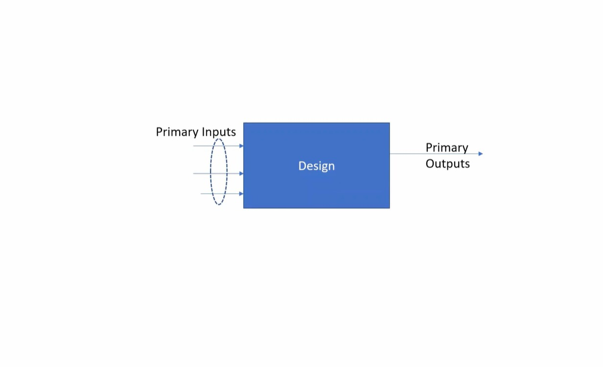
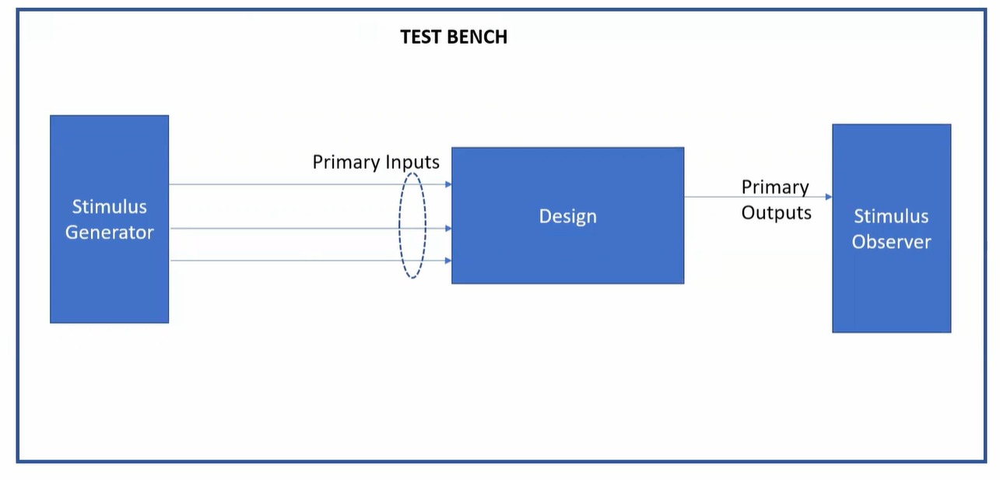
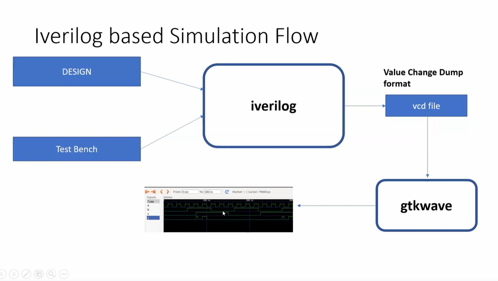
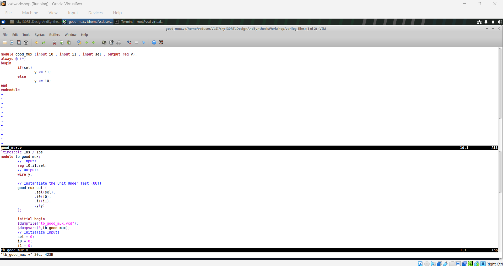
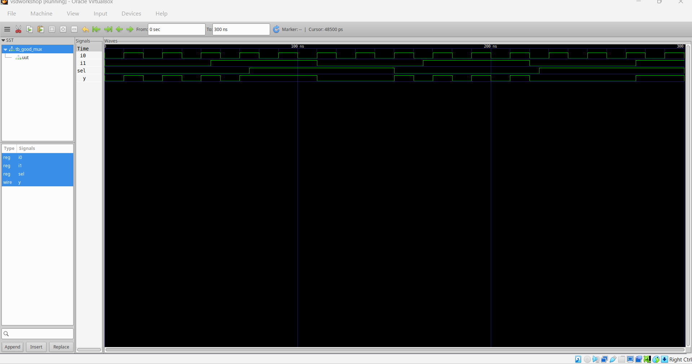
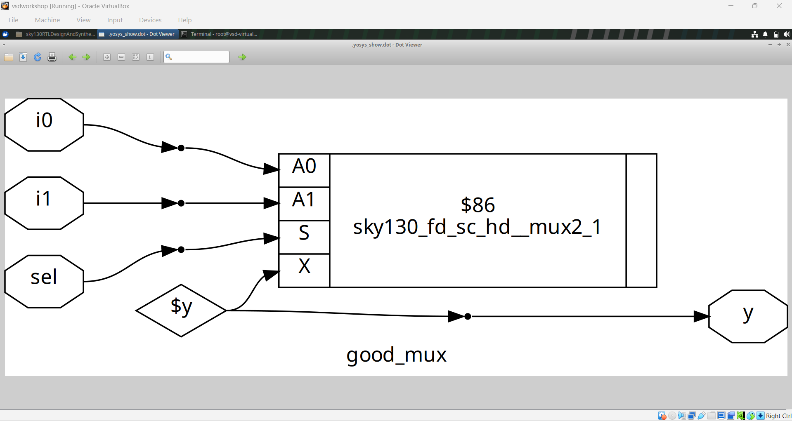

# Module 1: Introduction to RTL Design & Simulation

This module covers the fundamentals of **Register-Transfer Level (RTL) design, testbench architecture, simulation flow using Icarus Verilog (`iverilog`), Value Change Dump (VCD) waveform generation, and GTKWave analysis**.

The practical lab centers on a 2:1 Multiplexer (`good_mux`), verifying its functionality through simulation and introducing standard RTL-to-hardware synthesis concepts.

---

## Table of Contents

- [1. Overview & Objectives](#1-overview--objectives)
- [2. Digital Logic & Design Representation](#2-digital-logic--design-representation)
  - [2:1 Multiplexer Specification](#21-multiplexer-specification)
  - [Design Input-Output View](#22-design-input-output-view)
- [3. Testbench Architecture & Stimulus Generation](#3-testbench-architecture--stimulus-generation)
- [4. Icarus Verilog Simulation Flow](#4-iverilog-simulation-flow)
- [5. RTL Implementation & Testbench Code](#5-rtl-implementation--testbench-code)
- [6. Waveform Simulation & GTKWave Analysis](#6-waveform-simulation--gtkwave-analysis)
- [7. Introduction to RTL Synthesis](#7-introduction-to-rtl-synthesis)
- [8. Key Takeaways](#8-key-takeaways)

---

# 1. Overview & Objectives

In modern digital ASIC and FPGA design, RTL code written in Hardware Description Languages (such as Verilog HDL) specifies how data flows between registers and how logical operations are executed on that data.

The objectives of this module are:
- Understand RTL design fundamentals and module interfaces.
- Design a functional 2:1 multiplexer (`good_mux`).
- Build a structured Verilog testbench applying directed stimulus to the Design Under Test (DUT).
- Compile and execute simulations using open-source tools: **Icarus Verilog** and **GTKWave**.
- Understand VCD waveform files and perform signal verification.
- Connect pre-synthesis simulation behavior with synthesized gate-level representations.

---

# 2. Digital Logic & Design Representation

## 2.1 Multiplexer Specification

A 2:1 multiplexer selects between two data inputs (`i0` and `i1`) based on the value of a control/select signal (`sel`), routing the chosen input to output `y`.

### Truth Table

| `sel` | Output `y` | Description |
|:---:|:---:|:---|
| `0` | `i0` | Input `i0` is selected and routed to output |
| `1` | `i1` | Input `i1` is selected and routed to output |

### Boolean Equation

$$y = (\overline{\text{sel}} \cdot i_0) + (\text{sel} \cdot i_1)$$

## 2.2 Design Input-Output View

The block diagram below shows the primary input and output ports of the design under test:



- **Inputs:** `i0` (1-bit), `i1` (1-bit), `sel` (1-bit)
- **Output:** `y` (1-bit)

---

# 3. Testbench Architecture & Stimulus Generation

A **testbench** is an environment used to verify the functional correctness of a digital design. Crucially, a testbench module contains **no external input or output ports**.



### Key Components:
1. **Stimulus Generator:** Produces test patterns and toggles input signals (`i0`, `i1`, `sel`) across simulation time.
2. **Design Under Test (DUT):** An instantiation of the actual RTL design module (`good_mux`).
3. **Stimulus Observer:** Observes DUT responses through waveform logging (`$dumpfile`, `$dumpvars`) or automated assertions.

---

# 4. Icarus Verilog Simulation Flow

The simulation workflow utilizes **Icarus Verilog (`iverilog`)** for RTL compilation and execution, and **GTKWave** for waveform inspection.



### Step-by-Step Execution:

```bash
# 1. Compile the RTL design and testbench
iverilog good_mux.v tb_good_mux.v -o good_mux.out

# 2. Execute the compiled simulation binary to produce the VCD file
./good_mux.out

# 3. Launch GTKWave to view and inspect simulation waveforms
gtkwave tb_good_mux.vcd
```

During execution, `$dumpfile("tb_good_mux.vcd")` and `$dumpvars(0, tb_good_mux)` log all signal transitions to the Value Change Dump (VCD) file.

---

# 5. RTL Implementation & Testbench Code

The complete RTL implementation for the 2:1 multiplexer and its corresponding verification testbench:

```verilog
// good_mux.v - 2:1 Multiplexer RTL Design
module good_mux (
    input i0,
    input i1,
    input sel,
    output reg y
);
    always @(*) begin
        if (sel)
            y <= i1;
        else
            y <= i0;
    end
endmodule
```



---

# 6. Waveform Simulation & GTKWave Analysis

Running the simulation binary generates signal transitions confirming the multiplexer operates as expected:
- When `sel = 0`, changes in `i0` directly pass to `y`, while variations on `i1` have no effect.
- When `sel = 1`, changes in `i1` directly pass to `y`, while variations on `i0` have no effect.



---

# 7. Introduction to RTL Synthesis

Once the behavioral simulation is verified, RTL code is synthesized into a gate-level netlist using **Yosys** targeted to standard cell libraries:



The synthesized netlist implements the multiplexer multiplexing logic using target technology library cells (e.g., standard CMOS multiplexer or NAND/NOR/NOT gates).

---

# 8. Key Takeaways

1. **RTL Verification:** Always verify behavioral RTL functionality with thorough testbench stimulus before proceeding to synthesis.
2. **Simulation Artifacts:** The simulation flow produces an executable output which logs value transitions into a `.vcd` file for graphical inspection in GTKWave.
3. **Combinational Sensitivity:** All input control and data signals (`i0`, `i1`, `sel`) must be properly accounted for to avoid inferring unwanted latches.
4. **Synthesis Mapping:** Synthesis maps high-level behavioral constructs (`if-else`, `?:`, `case`) to optimized standard-cell logic gates.
